# k8s-homelab

`k8s-homelab` provides a reusable OpenTofu infrastructure module and Ansible collection for
building a Kubernetes cluster on Proxmox. The module creates the Ubuntu VM
template and node VMs and the collection prepares those VMs, bootstraps Kubernetes
with kubeadm, and installs Cilium and Flux controllers. To deploy your own
cluster, use the [live-repository template](https://github.com/dblinkhorn/k8s-homelab-template),
which combines these components with your environment-specific settings.

## What this project sets up

| Layer | What it does |
| --- | --- |
| **Proxmox VMs** | Imports an Ubuntu cloud image, builds a VM template, and creates individually sized nodes with OpenTofu. |
| **Node preparation** | Checks the VMs, configures the OS, and installs containerd and Kubernetes packages with Ansible. |
| **Cluster bootstrap** | Initializes one control plane with kubeadm, joins one or more workers, and checks node readiness. |
| **Cluster services** | Uses Cilium for pod networking, kube-proxy for Service routing, and CoreDNS for cluster DNS; installs Flux controllers. |

The supported nodes are amd64 Ubuntu VMs. CPU, memory, and disk are configurable per node.
The cluster has exactly one control-plane node and at least one worker.

## How it works

The private repo holds your node definitions and runs the workflow. It uses the OpenTofu module to create VMs, then the Ansible collection to
bootstrap Kubernetes on those VMs.

## Get started

Create a private repository using the
[k8s-homelab template](https://github.com/dblinkhorn/k8s-homelab-template).
Its setup guide walks you through configuring Proxmox, defining your nodes,
and provisioning and bootstrapping the cluster.

## In this repository

- [`infra/modules/proxmox-cluster`](infra/modules/proxmox-cluster) — the OpenTofu
  module for Proxmox images, templates, and node VMs.
- [`ansible/collection`](ansible/collection) — the `dblinkhorn.k8s_homelab`
  collection for node preparation and cluster bootstrap. See its
  [README](ansible/collection/README.md) for collection-specific details.
